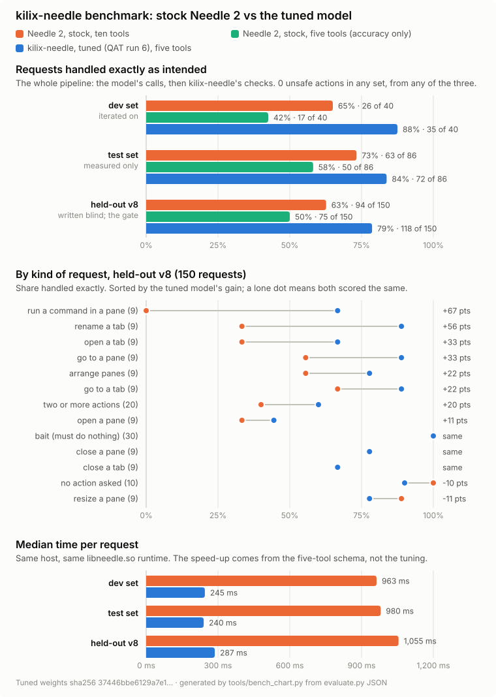

# kilix-needle

Drive Kilix panes, tabs, apps and coding-agent sessions, search files, and query
Linux system state. kilix-needle combines request grammars with
[Needle 2](https://huggingface.co/Cactus-Compute/needle2), a 45M-parameter
tool-calling model that runs on the CPU in about 45 MB of RAM.

**Status:** a Kilix content catalog app (`kilix-needle`, shown as Needle).
Plebian-OS installs it at first boot from the catalog pin and stages Ask's
command model; the Plebian-OS 0.2.3 RC6 candidate selects `a887e2fa`.
`kilix ask` runs it. This main branch can contain later development; use a
release's pinned catalog for its exact revision.

## What it does

- Routes a plain request to one job (`kilix-needle ask`, which `kilix ask`
  runs) and acts only after that job's own checks and consent.
- Opens, focuses, resizes, renames and closes Kilix panes and tabs, and types
  commands into panes at a shell prompt.
- Launches apps and games, changes Kilix settings, and controls audio, music,
  voice and text size.
- Starts, resumes, waits for and messages coding-agent sessions.
- Searches files, reads Linux system state, reads recorded pane logs, and
  drives tmux servers and persistent pane sessions by exact grammar.
- Serves all of this to agent harnesses as an MCP server.

Experimental [desktop actions](docs/desktop.md) add `kilix-desktop` typed commands,
JSON batches, `kilix desktop-action`, grammar/Needle/hybrid parsing and an opt-in
desktop MCP menu. Every route shares one bounded X11 executor; previews are the
default and typing never implicitly presses Enter.

Experimental [Windows actions](docs/windows.md) launch, focus and type into
Windows applications and press their buttons by name through the Kilix Windows
desktop SDK, inside WSL or over SSH with `--host`.

## Quick start

Plebian-OS installs Needle at first boot. With Kilix elsewhere,
`kilix app install kilix-needle` installs the catalog's pinned revision, and
`kilix app run kilix-needle -- ARGS` runs it until `kilix-needle setup` (below)
puts the command on your PATH. Some requests:

```sh
kilix-needle is docker running  # no job named: routed to the system job
kilix-needle ask --plan "open the pdf viewer"   # the route, then the apps plan
kilix-needle split right
kilix-needle close tab 2 and go to tab 1
kilix-needle make it a grid
kilix-needle                    # a prompt loop, one request per line
kilix-needle --dry-run close this pane
kilix-needle --yes close tab 2  # no question; for scripts and agents
kilix-needle agents "open codex in kilix-needle: review the diff"
kilix-needle agents --dry-run "open grok here in a split on the right"
kilix-needle system "show memory"
kilix-needle system --json "can you look at cpu load for me"  # tuned proposal only
```

Requires Python 3.11+ on Linux x86-64, run inside Kilix. It has no Python
dependencies. Fine-tuning, which is optional, builds its own environment.

## Setup

```sh
git submodule update --init
kilix-needle install              # licence screen, typed agreement, download
kilix-needle setup --dry-run      # see what setup would change
kilix-needle setup                # command, alias, hotkey, agent-harness tools
```

On first use at a terminal, a missing engine leads into `install`. It shows
kilix-content's licence screen for `needle2` and takes the typed agreement
`accept needle2 from Cactus Compute, Inc.`. No flag answers it. `--from DIR`
installs from bytes you already hold, with no network. After installing,
kilix-needle offers to fine-tune (see below).

`setup` links `~/.local/bin/kilix-needle`, adds `alias kn=kilix-needle`, binds
`ctrl+alt+space` to kilix-needle as an overlay that acts on the pane beneath it,
and registers `kilix-needle mcp` with Claude Code, Codex, Grok and the host
omp. It is idempotent: `--undo` reverses it, edited files are backed up, and
a TOML or JSON edit that would not parse is not written. `--only NAME,...`
limits it to some surfaces.

Workflows setup and model readiness (`kilix-needle workflows`) are described
in [docs/workflows.md](docs/workflows.md).

## Usage

| Job | Command | What it does |
| --- | --- | --- |
| routed | `kilix-needle ask REQUEST` | Chooses the job for a plain request ([routing](docs/routing.md)) |
| `panes` | `kilix-needle REQUEST` | Kilix panes and tabs ([panes job](docs/panes.md)) |
| `apps` | `kilix-needle apps REQUEST` | Apps, games, settings and exact audio, music, voice and text-size controls ([apps job](docs/apps.md)) |
| `agents` | `kilix-needle agents REQUEST` | Coding-agent sessions ([below](#the-agents-job)) |
| `files` | `kilix-needle files REQUEST` | Read-only file search and previews ([files guide](docs/files.md)) |
| `system` | `kilix-needle system REQUEST` | Read-only resources, processes, services, journal and packages ([system job](docs/system.md)) |
| logs | `kilix-needle logs ...` | Recorded pane logs, with citations ([below](#read-pane-logs)) |
| `tmux` | `kilix-needle tmux --socket PATH REQUEST` | One tmux server on an explicit socket ([tmux guide](docs/tmux.md)) |
| `pty` | `kilix-needle pty REQUEST` | Persistent pane sessions ([pty guide](docs/pty.md)) |
| `desktop` | `kilix-needle desktop REQUEST` | Experimental X11 actions ([desktop actions](docs/desktop.md)) |
| `windows` | `kilix-needle windows REQUEST` | Experimental Windows actions ([Windows actions](docs/windows.md)) |
| MCP | `kilix-needle mcp` | The same jobs as MCP tools ([agent harnesses](#agent-harnesses)) |

`--dry-run` resolves a request and runs nothing; `--yes` answers a
confirmation in advance, but only for a plain instruction. Every job and its
proposer are listed in [docs/jobs.md](docs/jobs.md).

### Paths and placement in Ask commands

Ask's shared command contract, its models and its benchmark are in
[docs/ask-commands.md](docs/ask-commands.md). Paths and placement:

An unquoted path may contain single spaces only when that exact path exists:
a directory for an agent, a file for the PDF viewer. `start codex in /work/my
project` reads `/work/my project` when that directory exists, and the words
after the longest existing path are read as before, so `start codex in
/work/my project on the right` keeps its placement. When a shorter existing
path also reads the whole request differently, as `start claude in ~/proj new
tab` beside folders `~/proj` and `~/proj new`, the request is refused. Ask only
stats such a path; it never opens or lists it. Double-quote a path with spaces
to read it exactly whether or not it exists, and quote paths with literal
trailing punctuation. A final `.` or `!` on an unquoted path at the end of a
request ends the sentence: `start codex in /work/project.` uses
`/work/project`, while `start codex in "/work/project."` preserves the final
dot. Quoted paths and message/task text keep their exact spelling.

A location can precede a launch: `In "/work/project", start Codex.`
`Wait until Codex completes its turn`, `I want the calculator opened`, and
`Open the calculator in this session` are also supported. Sentence punctuation
after a quoted PDF path stays outside the filename. A bare `right`, `left` or
`down` directly after the agent name and before an explicit path is its
placement: `start codex left in /work/project` opens a split to the left.
`right now`, `right here`, a bare direction without a path, `up` (as in `start
claude up`) and a direction after `the` or a session noun (`the Codex session
left in ~/proj`) are not placements, and such requests are refused.

At most four ordered command actions are admitted together. Host checks run
for the complete batch before it starts, and pending readiness pauses later
actions. Planning runs nothing; acting requires confirmation or `--yes`.
Reuse the returned operation ID to check an incomplete operation without
launching another copy or sending a message twice. A submitted message is
reported as submitted; it does not imply the recipient completed the task.

## Agent harnesses

`kilix-needle mcp` is an MCP server over stdio. It offers `kilix_plan`, which
resolves a request and runs nothing, and `kilix_act`, which runs it; closing,
typing and starting a program need `confirm_risky=true`. The plain CLI works
too: `kilix-needle --agent --json --yes REQUEST` prints one JSON record. Don't
expose it inside omp.sh's Docker sandbox: its network namespace cannot reach
Kilix's abstract socket.

What an agent should know (measured in a Codex route benchmark, 2026-09-29):

- **Each job has its own command:** `kilix-needle agents`, `apps`, `system`,
  `files`, `logs`, `tmux` and `pty`. The bare command is the panes job only. A refused record
  carries `hint`: the job whose grammar reads the request, or one accepted
  phrasing for what was refused. Restate the request once in that form rather
  than guessing.
- **Pane ids work as targets:** "close pane 70", "run 'make' in pane:70" (the
  ids `kilix pane` prints).
- **Canonical pane commands skip the model entirely**, and still pass every
  check and confirmation: close, go to or type into a pane named by title,
  name, side or id, and close or go to tab N. Examples: "close the pane titled
  build in this tab", "run 'make' in pane 70", "go to tab 2" (`panes_exact.py`).
  Navigation also reads "go to the tab before this one" and "focus whichever
  pane comes next" directly. Next/previous count from the caller's pane or tab
  and wrap at an edge; an ambiguous title still refuses resolution.
- **A yes given in advance covers these typing forms:** "run 'X' in the NAME
  pane", "type the command X into pane NAME", with an optional "and press
  Enter", and "In the pane titled NAME, type and press Enter on: X".
  Missing command text refuses before loading the model.
  A plain split also reads "open a new pane directly to the right of the pane
  I am running in and run a shell there" without loading the model.
- **Plain `sh` panes accept typed commands** when only the shell holds the
  terminal. `bash`, `zsh` and `fish` still need shell integration's prompt mark.
- **The agents job accepts an explicit directory**: "start codex in /abs/dir",
  also "an interactive Codex session in a new tab, working in the directory
  /abs/dir. Do not give it a task." The grammar also reads "working directory
  /abs/dir", "leave the session without a task", and "leave it at its
  interactive prompt". A task combined with an instruction to give no task
  still refuses; text after a task delimiter remains literal. "Launch claude
  in a new tab" uses the caller's current directory and needs no model.
- **The Codex entry that `setup` writes forwards the Kilix, `GPU_TERMINAL_*`,
  XDG and kitty auth variables.** Re-run `kilix-needle setup --only codex` after
  an update.

For one exact pane operation, a direct `kilix pane` verb costs an agent less
than a Needle call. Needle is for requests in a person's words.

## Read pane logs

The experimental `logs` command reads recorded evidence without loading an
action model. It can index Claude and Codex JSONL sources or committed plain
UTF-8 recording lines. Structured tool output retains its tool role even when
its text looks like a user message.

```sh
kilix-needle logs brief --session claude-needle
kilix-needle logs events --file /path/to/rollout.jsonl --provider codex --json
kilix-needle logs search --session claude-needle --query "parser" --limit 10
kilix-needle logs source --event evt-ID --json
kilix-needle logs cache status
kilix-needle logs cache clear
```

`--session` selects a pane by ID, coding-session ID, broker ID, or unique title;
ambiguous selectors fail. `--file` requires an explicit provider: `claude`,
`codex`, or `raw`. Zstandard archives additionally require `zstd`. The pinned
`third_party/kilix-tui-utils` submodule supplies structured adapters.

A raw pane recording that contains terminal controls is replayed on a virtual
screen by the pinned `third_party/kilix-transcript-clean` submodule. Records
are the lines that screen showed, in reading order, without the program's
status lines and prompt boxes. This covers full-screen programs such as Grok,
omp and the shell around them. A screen line cannot be traced to one byte
range, so each replayed record spans the whole snapshot. Its `origin.replay`
gives its line number and the program that drew it, and the source's `replay`
says whether the recording's start was cut and whether it carried the pane
size. Without the submodule, such a recording is reported as a
`terminal_controls` gap, as before.

Citations, coverage, exit codes, the cache and the limits of raw recordings are
described in [docs/logs.md](docs/logs.md).

## The agents job

`kilix-needle agents "…"` starts Claude Code, Codex, Grok or Qwen OMP
(`qwen-omp`) in an existing directory, waits for a session, or sends it a
message. Launches open a new tab by default; a request can choose a split,
model, task or session to resume.

```sh
kilix-needle agents "open codex in kilix-needle: review the diff"
kilix-needle agents --dry-run "open grok here in a split on the right"
kilix-needle agents "resume codex session 01a0dab8 in kilix"  # use your session ID
kilix-needle agents "wait until the codex session in kilix is idle"
kilix-needle agents "tell the codex session in kilix not to push"
```

The MCP tools are `kilix_agents_plan` and `kilix_agents_act`. The plan tool
and CLI `--dry-run` resolve the request without performing its actions.
The model sees three tools: `agent`, `wait` and `tell`.

**Consent and checks.** An admitted agents request is itself permission to
run; it needs neither a second confirmation nor `--yes` or `confirm_risky`.
The checks require every proposed action and argument to match the request,
including the directory, client, model, resume target and exact message or
task text. If any part is refused, nothing runs. Actions execute in order
and stop on the first failure. Starting a client records trust for that
directory. Approval skipping follows Kilix's coding-yolo setting; a request
cannot turn it on.

**Directories and sessions.** Use an absolute path, `~/…`, or `here` for
the calling pane's directory. Named aliases come from
`~/.config/kilix-needle/dirs.json`, a JSON object mapping names to absolute
paths. Otherwise a unique exact checkout name is resolved under
`~/gpu_terminal`, scanning to depth three. Short or generic names and
ambiguous matches are refused. Research directories need an explicit path
or configured alias. A session reference must identify one live coding
session; `it` refers to the session launched earlier in the same request.

**Waiting and messaging.** Only **Claude Code** sessions have a state Kilix can certify, so only
they can be waited on or messaged. Waits can target idle (turn finished) or waiting (the client asks
something). Messages are held when a session is waiting on an approval or menu; a working Claude
session may be steered. Codex, Grok, Qwen OMP and Kimi sessions (and any other pane whose state is
`agent`) are refused for `tell` and `wait` with a message that says Kilix cannot read their state:
none of them writes a record that names the session a process runs now. Launching them (`agent`)
still works. These are session controls, not arbitrary keystrokes into a pane.

An agent that runs inside tmux (for example a restored `tmux new-session … claude --resume …`)
is not visible to Kilix: the pane's foreground program is tmux, so its state cannot be read
and no message is sent into it. A request for such a session says so and names the tmux panes
with the command that reaches each one's server (`kilix-needle tmux --socket SOCKET 'list sessions'`,
or `tmux -S SOCKET attach`) **only when the socket is established exactly**. The socket is the tmux client's own, read structurally from its
command line (`-S`, `-L`, `-f` and their arguments; a relative `-S` is resolved against the
client's directory) and from the client's `/proc/<pid>/environ` (`TMUX`, `TMUX_TMPDIR`), never
from needle's environment; it is shell-quoted. Clients running in the requested directory are
named first and alone; when none is, clients elsewhere are named as leads, and the message says
the directory an agent works in inside tmux is not visible. When the socket cannot be
established (a listing entry with no valid pid, an option that cannot be read, an unreadable or
over-long client command line or environment, a relative `-S` with an unknown directory, an empty `-S`
or `-L`, a relative or malformed `$TMUX`, non-UTF-8 text, or a client whose command line or directory
differs from the listing, or changes while it is read: they are read, then read again) the message says so,
names no socket, and says how to find it (`tmux display-message -p '#{socket_path}'` inside that pane). A
`-S` path is left as written, so the filesystem resolves any `..` through symlinks; `$TMUX` is cut at its
first comma as tmux does, and only when it is exactly `PATH,PID,SESSION`.

**Why only Claude.** Kilix reads a state only from a record that names the process instance and
its session exactly (Claude's registry row: pid, `procStart`, the process's own config directory,
checked again when used). Codex has none (a rollout is opened per write, `/resume` switches sessions
in place, a PID can be reused), Grok's registry and OMP's files were matched by PID existence or by
directory and time, and Kimi exposes nothing; their panes read `agent` and needle refuses to send to or
wait on them, until such a record exists. See the kilix-tui-utils README ("Where an agent's state
comes from").

## How it works

Every job has a proposer and checks. The proposer (a grammar, or a small local
model such as tuned Needle 2 for the panes and agents jobs or LFM2 for Ask's
commands) suggests calls; the checks read the whole request themselves and
admit a call only if the request says it, so a proposer that invents a call
gets it refused. Closing, typing and starting a program wait for a person's
yes. Admitted actions run as `kilix @ ...` argv over the instance socket, never
through a shell. The engine and any tuned weights are verified against pinned
digests before they run. Request grammars and a local classifier with
checked-in weights pick the job for a routed request. Everything kilix-needle
keeps lives under `~/.local/gpu_terminal/kilix-apps/kilix-needle`, including a
private request history that `KILIX_NEEDLE_HISTORY=0` turns off.

<picture>
  <source media="(prefers-color-scheme: dark)" srcset="docs/bench-dark.svg">
  
</picture>

The chart is generated from [docs/bench.json](docs/bench.json) by
`tools/bench_chart.py`; [docs/engine-and-tuning.md](docs/engine-and-tuning.md)
explains the numbers.

## Documentation

- [docs/routing.md](docs/routing.md) — how `ask` chooses a job, and the router's provenance
- [docs/ask-commands.md](docs/ask-commands.md) — Ask's shared command contract, LFM2, Needle 3 and LFM3, and the LFM2 benchmark
- [docs/workflows.md](docs/workflows.md) — `kilix-needle workflows` setup, selection and readiness
- [docs/jobs.md](docs/jobs.md) — every job, its proposer, and how defaults change
- [docs/panes.md](docs/panes.md) — the panes job: what it can do, why it asks and what it refuses
- [docs/apps.md](docs/apps.md) — the apps job; [docs/apps-controls.md](docs/apps-controls.md) — its exact controls
- [docs/system.md](docs/system.md) — the system job, its normalizer and its filters
- [docs/other-jobs.md](docs/other-jobs.md) — file search, tmux, persistent pane sessions and structured actions
- [docs/files.md](docs/files.md), [docs/tmux.md](docs/tmux.md), [docs/pty.md](docs/pty.md), [docs/actions.md](docs/actions.md) — the guides for those jobs
- [docs/desktop.md](docs/desktop.md) and [docs/windows.md](docs/windows.md) — experimental desktop and Windows actions
- [docs/logs.md](docs/logs.md) — the pane-log reader in detail
- [docs/engine-and-tuning.md](docs/engine-and-tuning.md) — the engine, fine-tuning, measurements and the kilix-ml bridge
- [docs/lfm2-output-format-benchmark.md](docs/lfm2-output-format-benchmark.md) and [docs/lfm2-v21-benchmark.md](docs/lfm2-v21-benchmark.md) — earlier LFM2 reports
- [docs/state-and-history.md](docs/state-and-history.md) — the state directory and the request history
- [docs/known-issues.md](docs/known-issues.md) — known issues
- [docs/source-files.md](docs/source-files.md) — what each source file does
- [docs/releases.md](docs/releases.md) — the earlier release status
- [router-model/README.md](router-model/README.md) and [evals/system/README.md](evals/system/README.md) — router provenance and system evaluation scope

## Related repositories

- [kilix](https://github.com/itsmygithubacct/kilix#readme) — the terminal Needle drives; `kilix ask` runs Needle's Ask
- [kilix-content](https://github.com/itsmygithubacct/kilix-content#readme) — the catalog that pins Needle, and its licence flow (submodule)
- [kilix-ml](https://github.com/itsmygithubacct/kilix-ml#readme) — the tuning library and domain packs (submodule)
- [kilix-tui-utils](https://github.com/itsmygithubacct/kilix-tui-utils#readme) — structured log adapters and agent state (submodule)
- [kilix-transcript-clean](https://github.com/itsmygithubacct/kilix-transcript-clean#readme) — replays raw pane recordings (submodule)
- [kilix-tmux](https://github.com/itsmygithubacct/kilix-tmux#readme) — the tmux backend behind the tmux job, through Kilix's copy

## Part of Plebian-OS

kilix-needle is one of the repositories behind
[Plebian-OS](https://github.com/itsmygithubacct/plebian-os#readme), a Debian
install whose desktop is [Kilix](https://github.com/itsmygithubacct/kilix#readme)
running the [Kilix 95](https://github.com/itsmygithubacct/kilix-95#readme)
desktop through [Pleb](https://github.com/itsmygithubacct/pleb#readme).
It is installed at first boot from the Kilix content catalog, and Ask's
command model is published as a release of this repository. The map of every
repository and how it ships is on the
[components page](https://github.com/itsmygithubacct/plebian-os/blob/main/docs/components.md).

## Licence

Needle 2 is published by Cactus Compute under the Apache License 2.0. Its
licence is shown and accepted through `kilix-needle install`.

The owned application source is MIT licensed. Third-party submodules and model
assets retain their own licences.

The licence text is in [LICENSE](LICENSE).
